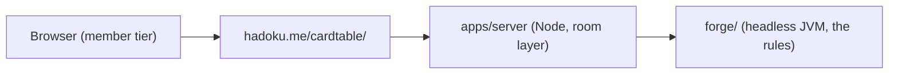

# Card Table: contributing

How to run, change and ship Card Table. What it does for a player is in
[features.md](features.md). The rules every change must keep are in the
repo's own [`AGENTS.md`](../../AGENTS.md) and
[`docs/ARCHITECTURE.md`](../ARCHITECTURE.md) — read those first; they are
short, and written from the actual Forge source rather than its reputation
([`docs/FORGE_ANALYSIS.md`](../FORGE_ANALYSIS.md)).

## Run it locally

```sh
git clone --recurse-submodules https://github.com/WolffM/hadoku-cardtable.git
cd hadoku-cardtable
pnpm install --frozen-lockfile
pnpm dev
```

Then open <http://127.0.0.1:9300/cardtable/>, signed in as a stand-in admin
with no account, service key or vault needed. Drafts and matches need a
Forge build: with a JDK 21, Maven and git on `PATH`, `pnpm dev` builds and
caches the submodule's jar the first time (a few minutes); with no JDK the
app still starts, just without drafts or matches. `README.md` has the full
table of dev env vars, and `docs/FORGE_JAR.md` covers the Forge build in
depth.

The first start also downloads Scryfall's card data, about 200 MB; card
art itself is never bundled, only looked up live from Scryfall's image
CDN. Everything the dev server writes goes under `.dev/` (logs in
`.dev/logs/server.log`). Room chat, sign-in and match stats are other
hadoku.me services and stay empty locally. Every browser window signs in
as the same local admin, so a two-person draft needs the e2e suite
(`pnpm e2e`), which signs each window in separately.

## Building

```sh
pnpm install --frozen-lockfile
pnpm run build
```

Builds from a fresh clone with no credentials — Node 24 and pnpm (pinned
by the `packageManager` field). The shared fleet packages it imports as
`@wolffm/*` (themes, prefs, the room layer and others) install from the
public npm registry as version-pinned `@hadoku/*` aliases in
`package.json`'s `dependencies`; the source of those packages lives in
other repos, some private, but nothing here needs it.

## How it fits together



- **Two processes on purpose.** The Node side never has to understand
  Magic; the JVM never has to understand rooms, chat or auth.
  [`docs/ARCHITECTURE.md`](../ARCHITECTURE.md) has the seam it is built on:
  Forge already factors "a player whose GUI lives elsewhere" into one class
  (`RemoteClientGuiGame`), so a browser client is that, wired through JSON
  instead of Java serialization.
- **Magic's own code lives under `games/magic/`**: packages for card data,
  decks and drafts, `server/` for the bridge and rooms, `ui/` for the board,
  draft and deck screens. It moved there from `apps/server` and `apps/ui` to
  leave room for more than one small game on the same room layer
  (`6f0c583`, `1c1ee38a4`, `8793ca5`; see
  [history.md#magic-moves-home](history.md#magic-moves-home)).
- **The room, chat and presence layer underneath `apps/server`** comes from
  a private companion repo's own code, not reimplemented here.
- **The draft bot** (`games/magic/server/src/room/draftbot.ts`) asks a
  private companion repo's hosted service for picks, with a local heuristic
  as its fallback — see
  [features.md#cube-drafting](features.md#cube-drafting).
- **`packages/`** is the generic, game-agnostic half of the hosting
  platform — `game-server`/`game-ui` (the room, match-hosting and UI shell
  any hosted game shares), `service-kernel` (edge auth, health, lifecycle),
  `host-wire`/`platform-wire`/`room-ask` (the wire formats), `shared`
  (the draft envelope's own schema) and `devkit` (release tooling). None
  of it knows Magic exists; `games/magic/` is what plugs into it.
- **`cubes/`, `decks/` and `drafts/`** are the data the deck library and
  cube drafting draw on: `.dck` cube and preconstructed-deck lists (one
  era per `decks/` subdirectory, back to 1995) and their matching
  `.draft` records — see
  [features.md#the-deck-library](features.md#the-deck-library).
- **Licensing is split, not one blanket GPL.** `forge/` and anything that
  touches Magic stays GPL-3.0-or-later; new platform code is MIT by
  default. [`docs/LICENSING.md`](../LICENSING.md) has the reasoning, and
  `scripts/layers/layers.json` (checked by a ratchet test in `pnpm run
  check`) is the actual record of which file is which — don't relicense a
  package by editing its `package.json` alone.
- **No card art ever enters the repo.** `.gitignore` refuses image files
  outright; a card's art is a lookup to a CDN mirror or Scryfall at request
  time, never a file here (`docs/LICENSING.md` §3.1).

## Gates

`pnpm run check` is what CI runs: lint, typecheck, unit tests, and
`scripts/layers/ratchet.test.ts`, which fails the build the moment an
import crosses a forbidden licence boundary, or a package's declared
licence stops matching what its files actually are.

`pnpm e2e` runs the specs under `e2e/`, driving a real multi-player draft
and match against a real Forge build through Playwright. It needs the
Forge jar and a JDK 21, which a plain clone does not have until `pnpm
dev` has built one.

## Deploy

Every green `check` on `main` redeploys PPE automatically — a
continuously-updated preview instance at `hadoku.me/cardtable-ppe/`, friend
tier. Production moves only on a manual, versioned release (`release.yml`),
which refuses to run unless that sha's `check` is green and a matching
`docs/releases/vX.Y.Z.md` exists. [`docs/RELEASE.md`](../RELEASE.md) and
[`docs/planning/release-process.md`](../planning/release-process.md) have
the exact steps.

## Trivia

A Forge source file's method-counting `grep` once miscounted the net
protocol's enum as 59 methods instead of 57: a `Mode.SERVER` and a
`Mode.MACRO` sit inside method bodies, not the enum itself, and an
unanchored `grep -c 'Mode\.'` counts them anyway. Re-deriving the table's
counts for the 2026-11-08 Forge pin caught it (`0e638b5a4`).
