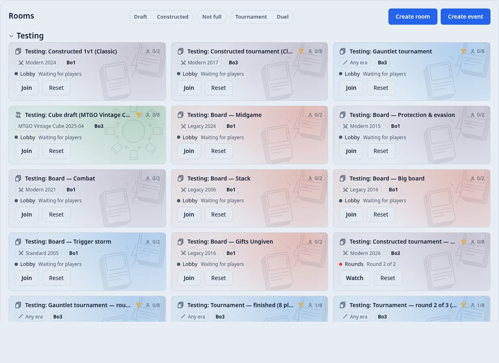

# Card Table

Card Table is a browser app for drafting Magic: The Gathering cubes and
playing the decks that come out of them, open to every signed-in member for
free. No sales, subs, ads or donations — see [`NOTICE.md`](../../NOTICE.md) —
and no public or anonymous access either.

Under the hood it is two processes behind one browser tab. A fork of
[Forge](https://github.com/Card-Forge/forge), the open-source Magic rules
engine, runs the real game headless on the server. A Node room layer, built
on a private companion repo's room, chat and presence code, owns everything
above a single match: lobbies, pods, presence, chat.
[`docs/ARCHITECTURE.md`](../ARCHITECTURE.md) has the full design and the seam
in Forge's own code that makes a browser client possible at all.

- [Features](features.md): what each part does and how to use it.
- [Contributing](contributing.md): running it locally, the build, the gates, how it ships.
- [History](history.md): the eras this became in, across two months and 5,500-odd commits.
- [Trivia](trivia.md)

## Trivia

The repo's very first commit (`7a2108d`) laid out the whole design in one
go — a Forge fork plus a browser room layer bolted onto Forge's own
server-authoritative netplay seam — before a single line of game logic
existed ([history](history.md#the-whole-plan-one-commit)).
